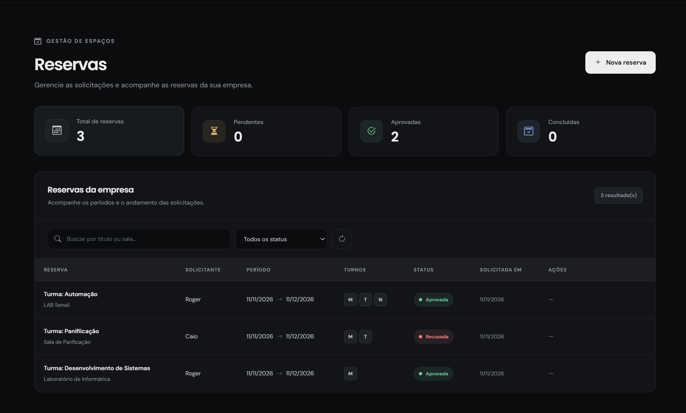
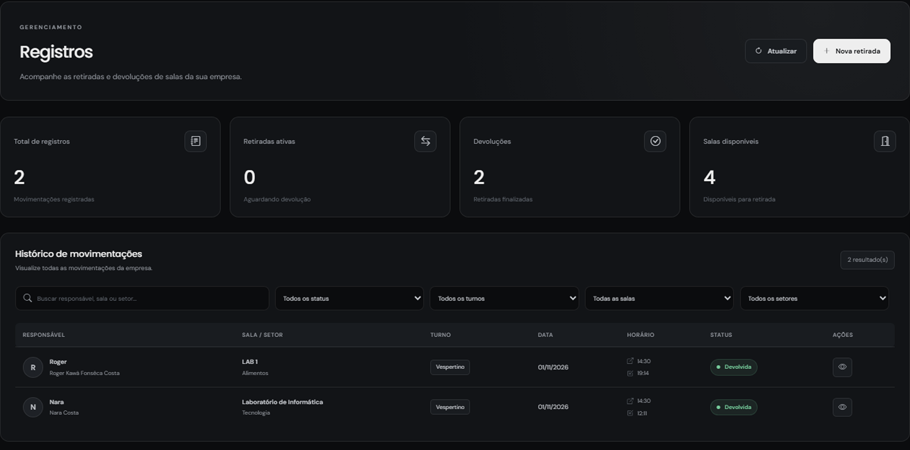
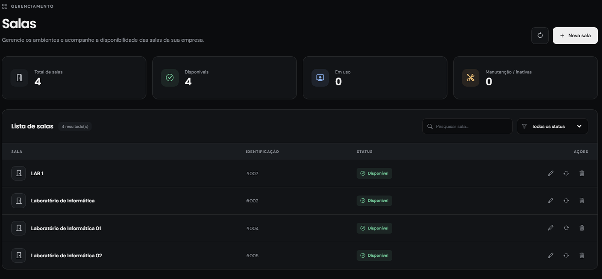
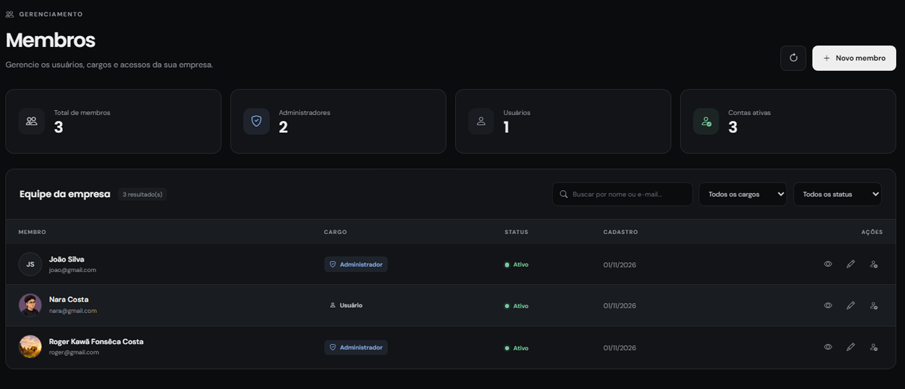
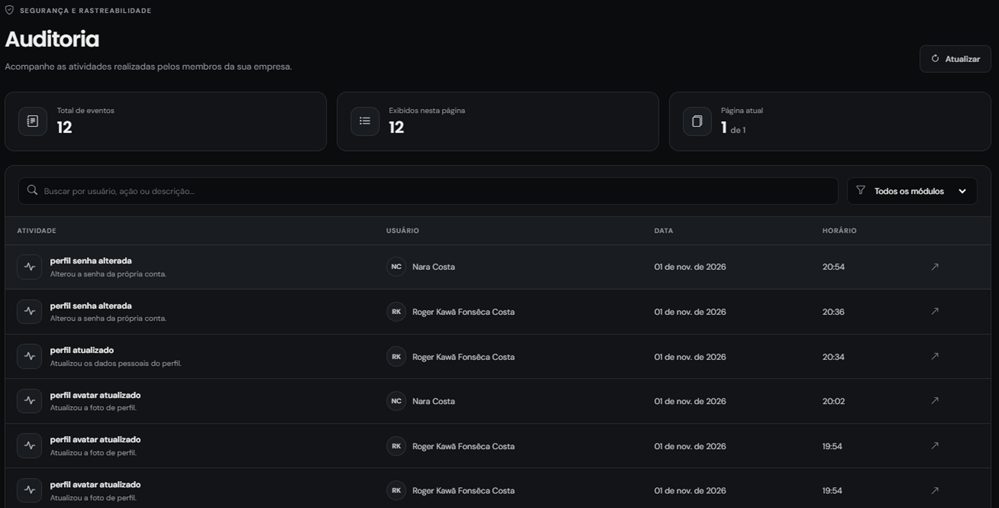
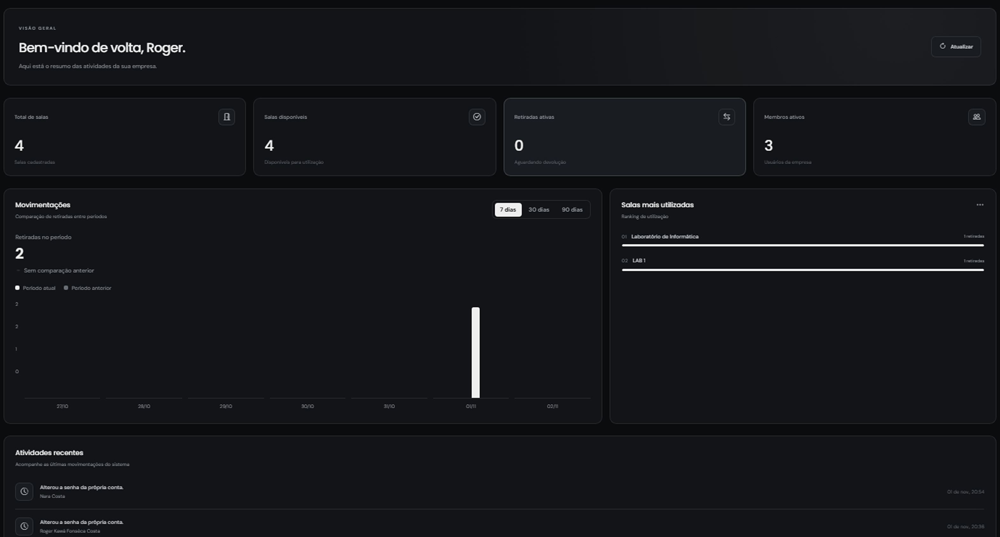

 

# KControl V3

### Sua operação. Sob controle.

Uma plataforma para organizar salas, pessoas e movimentações em um só lugar. Mais clareza para a rotina, mais segurança para a gestão.

[**Conheça o KControl**](https://www.kcontrol.site) · [**Repositório GitHub**](https://github.com/rogerkawa/KCONTROLV3)

---

## Novidade: Área de reservas

O KControl V3 recebeu uma nova área dedicada ao gerenciamento de reservas de salas. Agora, além de acompanhar retiradas e devoluções, os usuários podem solicitar a reserva de ambientes, enquanto os administradores gerenciam as solicitações e controlam os períodos de utilização.

**Entre os recursos adicionados:**

- Solicitação de reservas por sala, data e turno.
- Aprovação ou recusa de solicitações pelos administradores.
- Consulta das reservas e seus respectivos status.
- Cancelamento e gerenciamento de reservas.
- Solicitações de extensão de períodos reservados.
- Integração com os registros de movimentação, evitando conflitos entre reservas aprovadas e retiradas.
- Identificação dos períodos em que cada ambiente estará reservado.

A nova funcionalidade amplia o controle sobre a utilização dos ambientes e permite organizar a disponibilidade das salas com mais previsibilidade.

---

## Funcionalidades

O KControl reúne os principais processos de gerenciamento de ambientes em uma plataforma intuitiva e centralizada.

### 01. Registros e movimentações

Acompanhe retiradas e devoluções, consulte registros ativos e mantenha o histórico das movimentações organizado por turno.

### 02. Gestão de salas

Visualize os ambientes cadastrados, acompanhe a disponibilidade e identifique salas disponíveis, ocupadas, em manutenção ou inativas.

### 03. Pessoas e permissões

Gerencie os membros da organização, convide usuários e organize os níveis de acesso conforme as responsabilidades de cada perfil.

### 04. Auditoria e histórico

Consulte as atividades realizadas e tenha mais rastreabilidade sobre as operações executadas na plataforma.

### 05. Dashboard e indicadores

Tenha uma visão geral da operação com indicadores, atividades recentes e informações que ajudam a acompanhar a utilização dos ambientes.

### 06. Estrutura multiempresa

Uma arquitetura preparada para diferentes organizações, com usuários, ambientes e informações separados por empresa.

### 07. Segurança e controle de acesso

Autenticação, permissões por perfil, autenticação em dois fatores para SuperAdmin e registro de atividades importantes.

---

## Desenvolvedores

O KControl é construído por pessoas que acreditam que a tecnologia pode tornar tarefas do dia a dia mais simples, organizadas e eficientes.

<table>
<tr>
<td align="center" width="50%">
<a href="https://github.com/rogerkawa">

 <strong>Roger Kawa</strong>
 Desenvolvimento & produto
 
</a>
</td>
<td align="center" width="50%">
<a href="https://github.com/caiovictordev">

 <strong>Caio</strong>
 Desenvolvimento & produto
 
</a>
</td>
</tr>
</table>

---

## Tecnologias

O projeto utiliza tecnologias modernas para construir uma aplicação web responsiva, dinâmica e preparada para evoluir.

**Frontend**

**Backend e banco de dados**

**Ferramentas e serviços**

---

## Sua empresa pode ter uma gestão mais simples.

Chega de depender de anotações dispersas e processos difíceis de acompanhar. Conheça o KControl e descubra uma forma mais organizada de gerenciar ambientes e movimentações.

[**Acesse www.kcontrol.site**](https://www.kcontrol.site)

 

**KControl V3 — Sua operação. Sob controle.**

